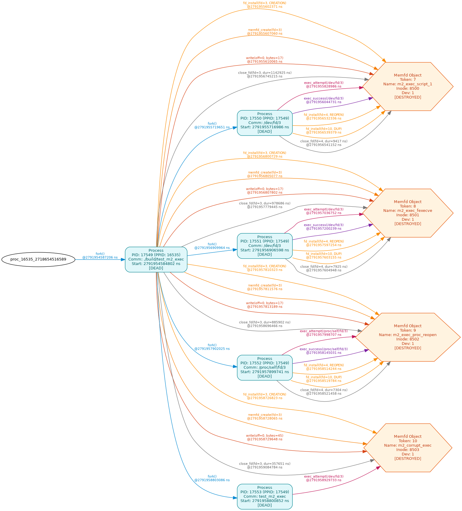
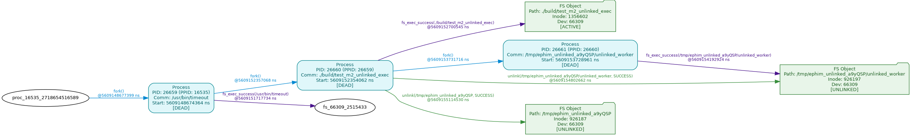

# EphimTrace — Visual Provenance Reconstruction Review & Baseline Contract

**Date**: 2026-11-27  
**Commit Baseline**: `1c33618` (branch `remediation/state-independence-and-loss-accountability`)  
**Context**: Delivery of GitHub Issue #9 Milestone 1: Inspectable Visual Provenance Reconstructions and Proposed Baseline Benchmark Contract.

---

## 1. Executive Summary & Verification State

To fulfill the first deliverable of **GitHub Issue #9**, this document presents inspectable visual provenance graphs generated from **verified, native evidence sessions with verified clean storage persistence (kernel loss counters unavailable in historical M2.4 manifests)** collected during Milestone M2 validation. No synthetic evidence, mock structures, or graph engine modifications were introduced.

Both mandated forensic scenarios were rendered using Graphviz `dot` (Graphviz 2.43.0) directly from the output files of the existing offline provenance engine (`build/replay`):
1. **Benign Memfd Execution** (`native_exec_7Q2iUm/session.evid` — 599 verified records, SHA-256 verified)
2. **Unlinked Regular-ELF Execution** (`native_unlinked_T4pJiz/session.evid` — 385 verified records, SHA-256 verified)

For each scenario, both the complete, unfiltered session graph (capturing all concurrent ambient host activity) and the isolated workload subgraphs are presented.

---

## 2. Scenario 1: Benign Memfd Execution

### 2.1 Evidence Integrity & Provenance Session Metadata
- **Evidence Path**: `tests1.0/kernel_telemetry/native_exec_7Q2iUm/session.evid`
- **Session SHA-256**: `569aef51377e93defa7929a2244864091ecdaa862c7380cfe38b0b2c59aafae1`
- **Manifest SHA-256**: `80656619285a68fc9395aa6a1005729fefb5e0f7b0394004a030a480cc2ebe37`
- **Validation Verdict**: `FINALIZED (Clean Persistence, Kernel Loss Counters Unavailable)` — 599 records verified, 599 replayed, 0 sequence gaps, 0 corruptions (kernel ring buffer drop counters were not captured in historical M2.4 manifests).
- **Reconstruction DAG Metrics**: 103 Nodes, 227 Edges (Full Session); Reconstructed in 1.9 ms (309,101 events/s).

### 2.2 Visual Graph Artifacts
- **Full Session Renderings**:
  - Full Session SVG: [full_memfd_session.svg](./images/full_memfd_session.svg)
- **Workload Subgraph Renderings**:
  - Workload PNG: [workload_memfd.png](./images/workload_memfd.png)
  - Workload SVG: [workload_memfd.svg](./images/workload_memfd.svg)
  - Workload DOT: [workload_memfd.dot](./dot/workload_memfd.dot)

### 2.3 Visual Representation (Workload Subgraph)

### 2.4 Node Inventory & Semantics
| Node Identifier in DOT | Node Type | Entity Identity / Key Attributes | Status / Inferred State | Role in Workload |
|---|---|---|---|---|
| `proc_16535_2718654516589` | Process | PID: 16535, PPID: 1 | ALIVE | Test Harness Runner (parent shell) |
| `proc_17549_2791954584802` | Process | PID: 17549, PPID: 16535, Comm: `./build/test_m2_exec` | DEAD | Main Test Harness Process |
| `memfd_7` | Memfd | Token: 7, Name: `m2_exec_script_1`, Inode: 8500, Dev: 1 | DESTROYED | Target of `execveat(AT_EMPTY_PATH)` |
| `proc_17550_2791955716986` | Process | PID: 17550, PPID: 17549, Comm: `/dev/fd/3` | DEAD | Child 1: Executed Memfd Script 1 |
| `memfd_8` | Memfd | Token: 8, Name: `m2_exec_fexecve`, Inode: 8501, Dev: 1 | DESTROYED | Target of `fexecve()` |
| `proc_17551_2791956906598` | Process | PID: 17551, PPID: 17549, Comm: `/dev/fd/3` | DEAD | Child 2: Executed Memfd Script 2 |
| `memfd_9` | Memfd | Token: 9, Name: `m2_exec_proc_reopen`, Inode: 8502, Dev: 1 | DESTROYED | Target of `/proc/self/fd/N` reopen exec |
| `proc_17552_2791957899741` | Process | PID: 17552, PPID: 17549, Comm: `/proc/self/fd/3` | DEAD | Child 3: Executed Memfd Script 3 |
| `memfd_10` | Memfd | Token: 10, Name: `m2_corrupt_exec`, Inode: 8503, Dev: 1 | DESTROYED | Target of Invalid ELF Execution |
| `proc_17553_2791958800852` | Process | PID: 17553, PPID: 17549, Comm: `test_m2_exec` | DEAD | Child 4: Aborted Execution (-ENOEXEC) |

### 2.5 Chronological Edge Walkthrough & Evidence Traceability

#### Test Case 1: Execution via `execveat(AT_EMPTY_PATH)`
1. **Creation & Population**:
   - `[2791955602371 ns]` `proc_17549` -> `memfd_7`: `fd_install(fd=3, CREATION)`.
   - `[2791955607060 ns]` `proc_17549` -> `memfd_7`: `memfd_create(fd=3)`.
   - `[2791955610065 ns]` `proc_17549` -> `memfd_7`: `write(off=0, bytes=17)` (script payload written).
2. **Process Spawn & Execution**:
   - `[2791955719651 ns]` `proc_17549` -> `proc_17550`: `fork()`.
   - `[2791955828986 ns]` `proc_17550` -> `memfd_7`: `exec_attempt(/dev/fd/3)` via `execveat`.
   - `[2791956044731 ns]` `proc_17550` -> `memfd_7`: `exec_success(/dev/fd/3)` (comm transforms to `/dev/fd/3`).
3. **Descriptor Lifecycle & Cleanup**:
   - `[2791956532336 ns]` `proc_17550` -> `memfd_7`: `fd_install(fd=4, REOPEN)`.
   - `[2791956539379 ns]` `proc_17550` -> `memfd_7`: `fd_install(fd=10, DUP)`.
   - `[2791956541152 ns]` `proc_17550` -> `memfd_7`: `close_fd(fd=4, dur=9417 ns)`.
   - `[2791956745215 ns]` `proc_17549` -> `memfd_7`: `close_fd(fd=3, dur=1142925 ns)`.

#### Test Case 2: Execution via `fexecve()`
1. **Creation & Population**:
   - `[2791956800729 ns]` `proc_17549` -> `memfd_8`: `fd_install(fd=3, CREATION)`.
   - `[2791956805077 ns]` `proc_17549` -> `memfd_8`: `memfd_create(fd=3)`.
   - `[2791956807802 ns]` `proc_17549` -> `memfd_8`: `write(off=0, bytes=17)`.
2. **Process Spawn & Execution**:
   - `[2791956909964 ns]` `proc_17549` -> `proc_17551`: `fork()`.
   - `[2791957036752 ns]` `proc_17551` -> `memfd_8`: `exec_attempt(/dev/fd/3)` via `fexecve`.
   - `[2791957200239 ns]` `proc_17551` -> `memfd_8`: `exec_success(/dev/fd/3)`.
3. **Descriptor Lifecycle & Cleanup**:
   - `[2791957597254 ns]` `proc_17551` -> `memfd_8`: `fd_install(fd=4, REOPEN)`.
   - `[2791957603155 ns]` `proc_17551` -> `memfd_8`: `fd_install(fd=10, DUP)`.
   - `[2791957604948 ns]` `proc_17551` -> `memfd_8`: `close_fd(fd=4, dur=7925 ns)`.
   - `[2791957779445 ns]` `proc_17549` -> `memfd_8`: `close_fd(fd=3, dur=978686 ns)`.

#### Test Case 3: Execution via `/proc/self/fd/N` Reopening
1. **Creation & Population**:
   - `[2791957810323 ns]` `proc_17549` -> `memfd_9`: `fd_install(fd=3, CREATION)`.
   - `[2791957811576 ns]` `proc_17549` -> `memfd_9`: `memfd_create(fd=3)`.
   - `[2791957813189 ns]` `proc_17549` -> `memfd_9`: `write(off=0, bytes=17)`.
2. **Process Spawn & Execution**:
   - `[2791957902025 ns]` `proc_17549` -> `proc_17552`: `fork()`.
   - `[2791957998707 ns]` `proc_17552` -> `memfd_9`: `exec_attempt(/proc/self/fd/3)`.
   - `[2791958145031 ns]` `proc_17552` -> `memfd_9`: `exec_success(/proc/self/fd/3)`.
3. **Descriptor Lifecycle & Cleanup**:
   - `[2791958514244 ns]` `proc_17552` -> `memfd_9`: `fd_install(fd=4, REOPEN)`.
   - `[2791958519784 ns]` `proc_17552` -> `memfd_9`: `fd_install(fd=10, DUP)`.
   - `[2791958521458 ns]` `proc_17552` -> `memfd_9`: `close_fd(fd=4, dur=7304 ns)`.
   - `[2791958696466 ns]` `proc_17549` -> `memfd_9`: `close_fd(fd=3, dur=885902 ns)`.

#### Test Case 4: Corrupted / Invalid Execution Abort (Negative Control)
1. **Creation & Population**:
   - `[2791958726823 ns]` `proc_17549` -> `memfd_10`: `fd_install(fd=3, CREATION)`.
   - `[2791958728065 ns]` `proc_17549` -> `memfd_10`: `memfd_create(fd=3)`.
   - `[2791958729648 ns]` `proc_17549` -> `memfd_10`: `write(off=0, bytes=45)` (invalid binary payload).
2. **Process Spawn & Rejected Execution**:
   - `[2791958803086 ns]` `proc_17549` -> `proc_17553`: `fork()`.
   - `[2791958929733 ns]` `proc_17553` -> `memfd_10`: `exec_attempt(/dev/fd/3)`.
   - **Crucial Negative Finding**: No `exec_success` edge exists in the DAG. The kernel rejected the execution with `-ENOEXEC`. Child 17553 retained its original comm `test_m2_exec` and terminated cleanly with expected exit status.
   - `[2791959084784 ns]` `proc_17549` -> `memfd_10`: `close_fd(fd=3, dur=357651 ns)`.

---

## 3. Scenario 2: Unlinked Executable Execution

### 3.1 Evidence Integrity & Provenance Session Metadata
- **Evidence Path**: `tests1.0/kernel_telemetry/native_unlinked_T4pJiz/session.evid`
- **Session SHA-256**: `63d7f3dc079b711f16d46563e92e5cda09aaef9af4817969d5bd3df47a6fea6e`
- **Manifest SHA-256**: `809f0b8b4ea042724f62a0383e6c875ea0355028e8815a16c1e0e6e7f2d6c96d`
- **Validation Verdict**: `FINALIZED (Clean Persistence, Kernel Loss Counters Unavailable)` — 385 records verified, 385 replayed, 0 sequence gaps, 0 corruptions (kernel ring buffer drop counters were not captured in historical M2.4 manifests).
- **Reconstruction DAG Metrics**: 58 Nodes, 152 Edges (Full Session); Reconstructed in 1.2 ms (318,190 events/s).

### 3.2 Visual Graph Artifacts
- **Full Session Renderings**:
  - Full Session SVG: [full_unlinked_session.svg](./images/full_unlinked_session.svg)
- **Workload Subgraph Renderings**:
  - Workload PNG: [workload_unlinked.png](./images/workload_unlinked.png)
  - Workload SVG: [workload_unlinked.svg](./images/workload_unlinked.svg)
  - Workload DOT: [workload_unlinked.dot](./dot/workload_unlinked.dot)

### 3.3 Visual Representation (Workload Subgraph)

### 3.4 Node Inventory & Semantics
| Node Identifier in DOT | Node Type | Entity Identity / Key Attributes | Status / Inferred State | Role in Workload |
|---|---|---|---|---|
| `proc_26659_5609148674364` | Process | PID: 26659, PPID: 16535, Comm: `/usr/bin/timeout` | DEAD | Outer timeout execution wrapper |
| `proc_26660_5609152354062` | Process | PID: 26660, PPID: 26659, Comm: `./build/test_m2_unlinked_exec` | DEAD | Unlinked Test Harness Coordinator |
| `fs_66309_1356602` | FS Object | Path: `./build/test_m2_unlinked_exec`, Inode: 1356602, Dev: 66309 | ACTIVE | Test harness binary file |
| `proc_26661_5609153728961` | Process | PID: 26661, PPID: 26660, Comm: `/tmp/ephim_unlinked_a9yQSP/unlinked_worker` | DEAD | Worker process executing unlinked binary |
| `fs_66309_926197` | FS Object | Path: `/tmp/ephim_unlinked_a9yQSP/unlinked_worker`, Inode: 926197, Dev: 66309 | UNLINKED | Target executable binary (unlinked while running) |
| `fs_66309_926187` | FS Object | Path: `/tmp/ephim_unlinked_a9yQSP`, Inode: 926187, Dev: 66309 | UNLINKED | Enclosing directory (unlinked while running) |

### 3.5 Chronological Edge Walkthrough & Evidence Traceability
1. **Harness Execution**:
   - `[5609152357068 ns]` `proc_26659` -> `proc_26660`: `fork()`.
   - `[5609152700545 ns]` `proc_26660` -> `fs_66309_1356602`: `fs_exec_success(./build/test_m2_unlinked_exec)`.
2. **Worker Process Spawn & Binary Execution**:
   - `[5609153731716 ns]` `proc_26660` -> `proc_26661`: `fork()`.
   - `[5609154192924 ns]` `proc_26661` -> `fs_66309_926197`: `fs_exec_success(/tmp/ephim_unlinked_a9yQSP/unlinked_worker)`.
     - Process 26661 maps and begins executing the ELF worker binary.
3. **Forensic Unlink Under Execution (Anti-Forensic Simulation)**:
   - `[5609154802662 ns]` `proc_26660` -> `fs_66309_926197`: `unlink(/tmp/ephim_unlinked_a9yQSP/unlinked_worker, SUCCESS)`.
     - Crucial Observation: The file is deleted from the directory tree while Process 26661 is actively executing from its inode. Node status updates to `[UNLINKED]`.
   - `[5609155114530 ns]` `proc_26660` -> `fs_66309_926187`: `unlink(/tmp/ephim_unlinked_a9yQSP, SUCCESS)`.
     - The parent directory itself is removed from the directory structure. Node status updates to `[UNLINKED]`.
4. **Forensic Reconstructibility**:
   - Even though the binary and its parent directory no longer exist on disk at the conclusion of the run, the provenance DAG maintains the exact causal chain:
     `proc_26660` -> `proc_26661` -> `fs_66309_926197` (with historical pathname `/tmp/ephim_unlinked_a9yQSP/unlinked_worker` and stable identity `dev=66309, inode=926197`), as well as the independent destructive action `proc_26660` -> `unlink`.

---

## 4. Methodological Distinctions & Integrity Contract

In strict compliance with Issue #9 and `PROJECT_STATE.md` reporting integrity guidelines, we formally separate observed telemetry from correlation models and graph inferences:

| Category | Telemetry Source / Mechanism | Represented Attributes & Guarantees | Epistemic Limits |
|---|---|---|---|
| **Observed Event** | Direct eBPF ring buffer records (`EVENT_FORK`, `EVENT_EXEC_ATTEMPT`, `EVENT_EXEC_SUCCESS`, `EVENT_FD_INSTALL`, `EVENT_MEMFD_CREATE`, `EVENT_CLOSE`, `EVENT_UNLINK`). | Exact monotonic kernel timestamp (`ktime_ns`), hardware event sequence number, PID/TID, exact syscall return status, file descriptors, byte lengths. | Only records system calls that executed and were successfully drained through the ring buffer. |
| **Correlated Identity** | eBPF maps & Userspace registry indexing. | Memfd `object_token` (allocated monotonically in kernel BPF map), File Inode/Dev tuple, Process `(pid, start_time_ns)` unique lifetime tuple. | BPF map state must handle PID/FD reuse and kernel map evictions cleanly. |
| **Reconstructed Inference** | Offline Provenance Engine (`engine.c`, `dag.c`). | Inode state transitions (`ACTIVE` -> `UNLINKED`), Memfd state (`DESTROYED` when all FDs closed), Process liveness (`ALIVE` -> `DEAD`), DAG edges connecting processes to targets. | Inferred states depend entirely on observing the terminating event. If an exit event was dropped or missed, the engine assumes the entity remains alive/active. |
| **Missing Evidence** | Hardware ring buffer drop counters or unobserved lifecycles. | Recorded explicitly as `UNAVAILABLE` or counted drops. | **Treated strictly as UNKNOWN, never as a negative observation or proof of non-occurrence.** |

### 4.1 Identified Provenance Engine Limitations (Under Issue #9)
1. **Process Exit Status Placeholder**:
   - Current DAG nodes mark processes as `[DEAD]` upon exit observation, but do not record the numerical exit code or terminating signal in the node attributes.
2. **Graph Allocation Error Handling**:
   - In `dag.c`, node and edge hash table expansions do not fail closed with fine-grained transactional rollbacks under memory allocation failures.
3. **Filtering Methodology**:
   - Full session captures contain ambient background processes (e.g. systemd, udev, git, starship). Filtering by PID or token isolates the relevant workload subgraph without altering the underlying immutable evidence file.

---

## 5. Proposed Provenance Benchmark Contract (For Review)

Before initiating quantitative benchmarking under Issue #9 Baseline Evaluation, we propose the following benchmark protocol and ground-truth specification:

### 5.1 Test Workloads & Independent Ground Truth
1. **Synthetic Deterministic Corpus** (Isolated Engine Verification):
   - Handcrafted, mathematically defined event streams containing precise edge sequences:
     - Sequential fork/exec/exit.
     - Intensive PID reuse and descriptor recycling.
     - Out-of-order arrival and simulated reservation loss bursts.
     - Known false-join and false-split attack sequences.
2. **Native End-to-End Workload Corpus**:
   - Fixed, repeatable executions with deterministic assertions:
     - `W_PACED`: Linear memfd creation, population, and descriptor close.
     - `W_BURST`: High-frequency concurrent memfd bursts.
     - `W_SUSTAIN`: Long-duration churn with active unlinks and reopens.
     - Anti-forensic unlinked binary execution.

### 5.2 Metrics & Evaluation Criteria
1. **Reconstruction Correctness**:
   - Precision & Recall on typed, directed edges.
   - Entity Identity Fidelity: 0 false joins across PID reuse cycles; 0 false splits across file renames or reopens.
   - Attribute Completeness: Exact token, inode, device, and timestamp preservation across 100% of reconstructed edges.
2. **Engine Scalability & Efficiency**:
   - Ingestion Throughput: Events replayed per second across varying graph sizes ($10^3$ to $10^6$ events).
   - DAG Query & Filter Latency: Subgraph extraction time as a function of total nodes and edge density.
   - Memory Footprint: Peak RSS (physical resident set) versus virtual mapping size during full DAG expansion.
   - Export Latency: DOT, JSON, and timeline serialization overhead.

---

## 6. Review Request

The visual reconstructions and evidence traces are submitted for review:
- [x] Full session and workload-specific visual graphs rendered to SVG and PNG.
- [x] Complete node, edge, and chronological raw evidence annotations provided.
- [x] Clear epistemic boundaries established between observed telemetry, correlated identities, and inferences.
- [x] Ready for approval before proceeding to quantitative baseline evaluation.
